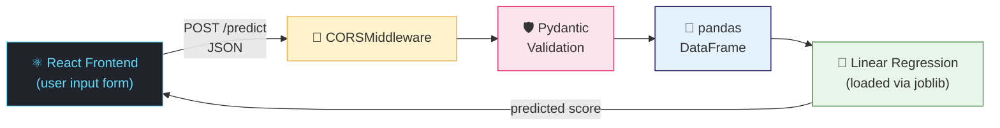

<div align="center">

# 🎓 Student Performance Score Prediction

**A full-stack machine learning app that predicts a student's performance score from their study data**

<br>

## 🧰 Tech Stack

<br>

🔵 **React** &nbsp;•&nbsp; 🟡 **Python** &nbsp;•&nbsp; 🟢 **FastAPI** &nbsp;•&nbsp; 🔴 **Pydantic**

🟣 **pandas** &nbsp;•&nbsp; 🟠 **scikit-learn** &nbsp;•&nbsp; 🟤 **joblib** &nbsp;•&nbsp; ⚪ **pathlib** &nbsp;•&nbsp; 🟢 **CORSMiddleware**

<br>

[Overview](#-overview) •
[Features](#-features) •
[Architecture](#-architecture) •
[Getting Started](#-getting-started) •
[API](#-api-reference) •
[Roadmap](#-roadmap)

</div>

---

## 📖 Overview

Which habits and factors actually shape a student's academic results? This project turns that question into a working tool.

A **Linear Regression** model is trained on tabular student data and served through a **FastAPI** REST API. A **React** interface lets anyone enter a student's details and instantly see the **predicted performance score**.

> 💡 **In one line:** enter student data → validate it → run the trained model → get a predicted score.

---

## 🧩 What Each Tool Does

| 🏷️ Technology | 🎯 Role in the project |
|---------------|------------------------|
| 🔵 **React** | Frontend UI for entering student data and showing the prediction |
| 🟡 **Python** | Core language for the backend and model training |
| 🟢 **FastAPI** | REST API that serves the trained model |
| 🔴 **Pydantic** | Validates request data (types, required fields) |
| 🟣 **pandas** | Loads and handles the tabular dataset |
| 🟠 **scikit-learn** | Train/test split and the `LinearRegression` model |
| 🟤 **joblib** | Saves the trained model and loads it at startup |
| ⚪ **pathlib** | Deterministic, OS-independent file paths |
| 🟢 **CORSMiddleware** | Lets the frontend and backend talk across different ports |

---

## ✨ Features

- 🖥️ **Interactive UI** for entering student details and viewing results
- ⚡ **Fast API** with automatic interactive docs at `/docs`
- 🛡️ **Input validation** so bad data never reaches the model
- 🤖 **Instant predictions** from a pre-trained Linear Regression model
- 💾 **Train once, reuse everywhere** with joblib model persistence
- 🔗 **Cross-port communication** handled with CORS
- 📂 **Portable file paths** that work on any operating system

---

## 🏗️ Architecture



### 🔄 How it works

| Step | Stage | What happens |
|:----:|-------|--------------|
| **1** | 📊 **Training** | The dataset is loaded with pandas and split into train/test sets using scikit-learn. A `LinearRegression` model is trained and saved with joblib. |
| **2** | 🚀 **Startup** | FastAPI loads the saved model using a pathlib-based path, so it works from any working directory. |
| **3** | ✅ **Validation** | Each request is checked against a Pydantic schema for types and required fields. |
| **4** | 🔮 **Prediction** | Validated input becomes a pandas DataFrame, goes through the model, and the score is returned as JSON. |
| **5** | 🌍 **CORS** | CORSMiddleware lets the React app call the API across different ports. |

---

## 📁 Project Structure

```text
student-performance-score-prediction/
│
├── 🐍 backend/
│   ├── main.py            # FastAPI app, routes, CORS setup
│   ├── schemas.py         # Pydantic request models
│   ├── train_model.py     # Trains and saves the model
│   ├── data/              # Dataset (CSV)
│   ├── model/             # Saved model (.joblib)
│   └── requirements.txt
│
├── ⚛️ frontend/
│   ├── src/               # React components
│   └── package.json
│
└── 📄 README.md
```

> ✏️ Update the names above to match your actual folder layout.

---

## 🚀 Getting Started

**Prerequisites:** Python 3.9+ and Node.js 18+

### 1️⃣ Clone the repository

```bash
git clone https://github.com/<your-username>/<your-repo>.git
cd <your-repo>
```

### 2️⃣ Start the backend

```bash
cd backend
python -m venv venv
source venv/bin/activate          # Windows: venv\Scripts\activate
pip install -r requirements.txt

python train_model.py             # train and save the model (run once)
uvicorn main:app --reload         # start the API
```

🟢 API running at **http://localhost:8000**
📚 Interactive docs at **http://localhost:8000/docs**

### 3️⃣ Start the frontend

```bash
cd frontend
npm install
npm run dev
```

🟢 App running at **http://localhost:5173** (or the URL shown in your terminal)

---

## 🔌 API Reference

### `POST` `/predict`

Returns the predicted performance score for a student.

<details open>
<summary><b>📥 Request body</b> (example, replace with your actual features)</summary>

```json
{
  "hours_studied": 6,
  "attendance": 92,
  "previous_score": 78
}
```

</details>

<details open>
<summary><b>📤 Response</b></summary>

```json
{
  "predicted_score": 81.4
}
```

</details>

<details>
<summary><b>⚠️ Error response</b></summary>

Invalid input returns **`422 Unprocessable Entity`** with details about which fields failed validation.

</details>

---

## 🗺️ Roadmap

- [x] Train a Linear Regression model with a train/test split
- [x] Serve predictions through FastAPI with Pydantic validation
- [x] Build the React frontend and connect it with CORS
- [ ] Compare with Random Forest and Gradient Boosting
- [ ] Show evaluation metrics (R², MAE, RMSE) in the UI
- [ ] Add charts and data visualisations
- [ ] Deploy frontend and backend online

---

## 📄 License

Distributed under the **MIT License**. See [`LICENSE`](LICENSE) for details.

---

<div align="center">

### 👨‍💻 Author

**Niraj Bhatta**
Computer Engineering Student, NCIT

🔗 [github.com/Niraj-Bhatta](https://github.com/Niraj-Bhatta)

<br>

⭐ If you found this project useful, consider giving it a star!

</div>